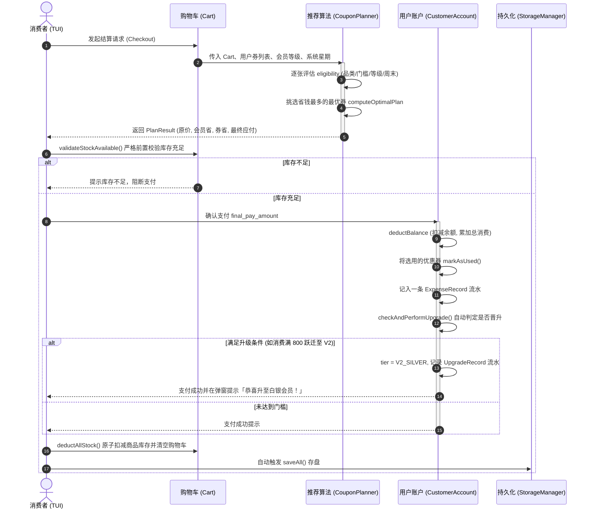

# 《用户权益管理与优惠规划系统》架构与接口设计规范 (DESIGN.md)

本文件定义本系统的工程目录结构、领域模型、类继承关系、全套头文件接口规范（API Contracts）以及团队分工协作边界。
所有代码实现必须严格遵循本文件定义的命名规范、类名、方法签名与行为语义。

---

## 1. 软件工程目录规范

参考工业级模块化 C++ 工程布局，头文件与源文件严格分离，构建产物集中输出至根目录 `bin/` 目录下。

```
d:\Project\C++\C++大作业/
├── DESIGN.md                     # 本设计规范文档 (单源权威事实)
├── CMakeLists.txt                # 现代 CMake 根构建脚本
├── .gitignore                    # Git 忽略配置
├── bin/                          # 最终生成的可执行二进制输出目录
│   ├── vip-coupon-system.exe     # 编译生成的目标程序
│   └── data/                     # 本地 JSON 持久化数据存放目录
│       ├── users.json            # 用户与账单数据
│       ├── products.json         # 商品库与库存数据
│       └── coupons.json          # 公共领券/购券池数据
├── build/                        # 构建临时缓存目录 (Ninja)
├── include/                      # 公共头文件根目录
│   ├── common/                   # 全局基础枚举与共享结构体
│   │   ├── Types.hpp             # 业务基础枚举 (等级/品类/时间/角色/星期)
│   │   └── Result.hpp            # 通用操作返回结果封装
│   ├── user/                     # 【郭熠成 负责】用户与权益管理系统
│   │   ├── Account.hpp           # 账户抽象基类
│   │   ├── CustomerAccount.hpp   # 消费者账户 (等级、成长值、卡券包、流水)
│   │   ├── AdminAccount.hpp      # 管理员账户 (基于 RBAC 的两级权限控制)
│   │   ├── TransactionRecord.hpp # 账单流水多态体系 (充值/消费/升级)
│   │   └── UserManager.hpp       # 账户注册、登录、查询与会话管理
│   ├── shop/                     # 【梁佳毅 负责】商品与购物车管理系统
│   │   ├── Product.hpp           # 商品实体与库存原子操作
│   │   ├── Cart.hpp              # 购物车明细与分品类金额统计
│   │   └── ProductManager.hpp    # 商品货架、检索、补货管理
│   ├── coupon/                   # 【梁佳毅 负责】优惠券与规划推荐引擎
│   │   ├── Coupon.hpp            # 优惠券抽象基类 (跨模块共享契约)
│   │   ├── ConcreteCoupons.hpp   # 派生券类 (满减券、折扣券、立减券)
│   │   ├── CouponPlanner.hpp     # 核心算法：可用性诊断与单券最优省钱求解器
│   │   └── CouponManager.hpp     # 优惠券中心 (发券、付费购券、兑换)
│   ├── persist/                  # 【梁佳毅 负责】数据持久化与仓储管理
│   │   └── StorageManager.hpp    # JSON 读写调度器与冷启动种子数据注入
│   └── ui/                       # 【梁佳毅 负责】FTXUI 显式状态机与页面架构
│       ├── Page.hpp              # 状态机跳转指令与页面纯虚基类
│       ├── PageManager.hpp       # 根组件页面栈管理器
│       ├── AppContext.hpp        # 全局共享上下文 (各管理器句柄与系统虚拟时间)
│       └── pages/                # 具体业务页面声明
│           ├── LoginPage.hpp     # 用户登录/注册/管理员入口
│           ├── MallPage.hpp      # 商城浏览与加购页
│           ├── CartPage.hpp      # 购物车管理页
│           ├── CheckoutPage.hpp  # 结算与最优优惠券弹窗页
│           ├── UserCenterPage.hpp# 个人中心 (等级进度/资产/流水)
│           ├── CouponSquarePage.hpp # 领券/购券广场页
│           └── AdminPage.hpp     # 管理员运营控制台页
└── src/                          # 源代码实现根目录
    ├── user/                     # 郭熠成 负责实现
    │   ├── Account.cpp
    │   ├── CustomerAccount.cpp
    │   ├── AdminAccount.cpp
    │   ├── TransactionRecord.cpp
    │   └── UserManager.cpp
    ├── shop/                     # 梁佳毅 负责实现
    │   ├── Product.cpp
    │   ├── Cart.cpp
    │   └── ProductManager.cpp
    ├── coupon/                   # 梁佳毅 负责实现
    │   ├── Coupon.cpp
    │   ├── ConcreteCoupons.cpp
    │   ├── CouponPlanner.cpp
    │   └── CouponManager.cpp
    ├── persist/                  # 梁佳毅 负责实现
    │   └── StorageManager.cpp
    ├── ui/                       # 梁佳毅 负责实现
    │   ├── PageManager.cpp
    │   └── pages/
    │       ├── LoginPage.cpp
    │       ├── MallPage.cpp
    │       ├── CartPage.cpp
    │       ├── CheckoutPage.cpp
    │       ├── UserCenterPage.cpp
    │       ├── CouponSquarePage.cpp
    │       └── AdminPage.cpp
    └── main.cpp                  # 梁佳毅 负责：系统初始化与状态机启动入口
```

---

## 2. 快速起手：拉取仓库与推荐构建命令（团队协作必读）

本项目使用 **CMake + Ninja** 构建系统进行管理。团队成员从 GitHub 克隆仓库后，在项目根目录下打开终端（PowerShell 或 CMD），按照以下标准工作流进行配置、编译与运行：

### 2.1 首次拉取与环境预配置（自动下载第三方依赖）
```powershell
# 1. 克隆仓库并进入工程根目录
git clone <你的 GitHub 仓库地址>
cd vip-coupon-system

# 2. 配置构建环境并自动通过 FetchContent 拉取第三方依赖 (nlohmann/json 与 ftxui)
# 说明：此命令会自动将最新版依赖下载到 build/_deps/ 目录，且不会编译任何业务代码
cmake -B build -G Ninja
```

### 2.2 日常编译构建与运行
```powershell
# 1. 增量/全量编译整个项目 (自动输出至 bin/vip-coupon-system.exe)
cmake --build build

# 2. 直接运行生成的可执行程序
.\bin\vip-coupon-system.exe

# 3. [快捷技巧] 一键编译并自动启动运行 (触发 CMake run 伪目标)
cmake --build build --target run
```

### 2.3 常用清理与工程重置命令
```powershell
# 清理所有编译产生的中间中间件 (.obj / .o 文件)
cmake --build build --target clean

# 当在 src/ 目录下新增或删除了 .cpp 文件时，系统会自动感知重新配置；
# 若需要完全清空环境从零重新拉取，只需删除 build 目录并重新执行配置：
Remove-Item -Recurse -Force build
cmake -B build -G Ninja
```

---

## 3. 团队双人分工与协作交付边界

工程采用**接口契约先行（Interface-First）**模式，杜绝循环依赖与互相等待：

```mermaid
graph TD
    subgraph 共享协议层
        T[include/common/Types.hpp]
        C[include/coupon/Coupon.hpp]
    end

    subgraph 阶段一：郭熠成 负责 (100%独立开工交付)
        U1[include/user/Account.hpp]
        U2[include/user/CustomerAccount.hpp]
        U3[include/user/AdminAccount.hpp]
        U4[include/user/TransactionRecord.hpp]
        U5[include/user/UserManager.hpp]
        UTest[本地 main.cpp 单元测试通过]
    end

    subgraph 阶段二：梁佳毅 负责 (系统接盘与闭环)
        S1[include/shop/ 商品与购物车模块]
        C1[include/coupon/ 派生券与最优规划算法]
        P1[include/persist/ StorageManager JSON持久化]
        UI[include/ui/ FTXUI 页面状态机与界面]
    end

    T --> U1
    T --> S1
    T --> C1
    C --> U2
    C --> C1
    U5 --> P1
    S1 --> P1
    C1 --> P1
    U5 --> UI
    S1 --> UI
    C1 --> UI
    P1 --> UI
```

* **郭熠成 交付物**：`include/user/*.hpp` 与 `src/user/*.cpp`。只需依赖 `include/common/Types.hpp` 与 `include/coupon/Coupon.hpp` 基类，即可独立编译并验证用户注册、登录、升级、扣款与流水。
* **梁佳毅 交付物**：商品、派生卡券、单券最优规划算法、JSON 持久化调度，以及利用 FTXUI 状态机搭建全部页面并将底层业务打通。

---

## 4. 全局共享基础定义 (`include/common/`)

### 4.1 `include/common/Types.hpp`
定义系统全局通用的强类型枚举与配置转换辅助函数。

```cpp
#pragma once
#include <string>

namespace core {

// 会员等级枚举 (V0 ~ V5)
enum class UserTier {
    V0_NORMAL = 0,    // 普通用户: 基础无折扣
    V1_BRONZE = 1,    // 青铜会员: 98折 (0.98)
    V2_SILVER = 2,    // 白银会员: 95折 (0.95)
    V3_GOLD = 3,      // 黄金会员: 90折 (0.90)
    V4_DIAMOND = 4,   // 钻石会员: 85折 (0.85)
    V5_SUPREME = 5    // 至尊会员: 80折 (0.80)
};

// 会员等级元数据配置 (数据驱动模式)
struct TierConfig {
    UserTier tier;
    std::string name;          // 等级中文名称
    double discount_rate;      // 基础全场折扣 (如 0.95)
    double upgrade_threshold;  // 晋升到该等级所需的累计总消费额 (元)
};

// 根据等级枚举获取配置信息 (避免为纯数据写 6 个派生类)
inline TierConfig getTierConfig(UserTier tier) {
    switch (tier) {
        case UserTier::V0_NORMAL:  return {tier, "普通会员", 1.00, 0.0};
        case UserTier::V1_BRONZE:  return {tier, "青铜会员", 0.98, 200.0};
        case UserTier::V2_SILVER:  return {tier, "白银会员", 0.95, 800.0};
        case UserTier::V3_GOLD:    return {tier, "黄金会员", 0.90, 2000.0};
        case UserTier::V4_DIAMOND: return {tier, "钻石会员", 0.85, 5000.0};
        case UserTier::V5_SUPREME: return {tier, "至尊会员", 0.80, 10000.0};
    }
    return {UserTier::V0_NORMAL, "普通会员", 1.00, 0.0};
}

// 账户身份类型
enum class AccountType {
    CUSTOMER = 0,     // 消费者前台账户
    ADMIN = 1         // 后台管理账户
};

// 管理员权限角色 (基于 RBAC 的两级安全划分)
enum class AdminRole {
    STAFF = 0,        // 运营管理员: 拥有商品上架/补货、发布优惠券、查看列表权限
    SUPER_ADMIN = 1   // 超级管理员: 拥有全部权限，包含直接修改用户等级、系统重置
};

// 商品品类划分
enum class ProductCategory {
    ALL = 0,          // 全品类通用 (专供优惠券使用：表示全场适用)
    DIGITAL = 1,      // 数码 3C
    CLOTHING = 2,     // 服饰鞋包
    FOOD = 3,         // 食品生鲜
    DAILY = 4,        // 日用百货
    OTHER = 5         // 其他
};

inline std::string getCategoryName(ProductCategory cat) {
    switch (cat) {
        case ProductCategory::ALL:      return "全品类通用";
        case ProductCategory::DIGITAL:  return "数码3C";
        case ProductCategory::CLOTHING: return "服饰鞋包";
        case ProductCategory::FOOD:     return "食品生鲜";
        case ProductCategory::DAILY:    return "日用百货";
        case ProductCategory::OTHER:    return "其他";
    }
    return "未知分类";
}

// 时间生效约束类型 (针对优惠券)
enum class TimeConstraint {
    ANYTIME = 0,      // 不限时间
    WEEKDAY_ONLY = 1, // 仅限工作日生效 (周一至周五)
    WEEKEND_ONLY = 2  // 仅限周末生效 (周六至周日)
};

// 星期枚举
enum class DayOfWeek {
    MONDAY = 1,
    TUESDAY = 2,
    WEDNESDAY = 3,
    THURSDAY = 4,
    FRIDAY = 5,
    SATURDAY = 6,
    SUNDAY = 7
};

inline bool isWeekend(DayOfWeek day) {
    return day == DayOfWeek::SATURDAY || day == DayOfWeek::SUNDAY;
}

// 浮点数金额安全比较 (防止 199.99999999 < 200.0 导致的偶发门槛未达标 Bug)
inline bool isAmountGTE(double a, double b) {
    return a >= b - 1e-4;
}

} // namespace core
```

### 4.2 `include/common/Result.hpp`
统一步骤执行的结果状态封装，提供语义清晰的成功/失败信息载体。

```cpp
#pragma once
#include <string>

namespace core {

struct Result {
    bool success;
    std::string message;

    static Result ok(std::string msg = "操作成功") {
        return {true, std::move(msg)};
    }

    static Result fail(std::string error_msg) {
        return {false, std::move(error_msg)};
    }
};

} // namespace core
```

---

## 5. 共享基类契约 (`include/coupon/Coupon.hpp`)

这是郭熠成模块与梁佳毅模块的唯一共享依赖契约。郭熠成的 `CustomerAccount` 只需要引入此头文件，即可通过智能指针管理用户背包中的卡券集合。

```cpp
#pragma once
#include "common/Types.hpp"
#include <string>
#include <memory>

namespace shop {

// 优惠券抽象基类 (面向对象多态核心)
class Coupon {
protected:
    std::string template_id;           // 券模板唯一编号 (如 "TPL_WEEKEND_20")
    std::string instance_id;           // 用户背包中的实例唯一编号 (如 "INST_20261028_0001", 模板库中为空)
    std::string name;                  // 券面显示名称 (如 "周末数码特惠满减券")
    double cost;                       // 购券费用 (0.0 为免费领取券，>0.0 为付费购买券)
    double min_spend;                  // 满减使用门槛 (元，订单或指定品类总额需达到该金额)
    core::ProductCategory target_cat;  // 限制适用品类 (若为 ALL 则全场适用)
    core::UserTier min_tier;           // 最低可用会员等级 (如需黄金 V3 以上)
    core::TimeConstraint time_limit;   // 时间生效约束 (工作日 / 周末 / 不限)
    bool is_used = false;              // 是否已被消费核销

    // 基础属性序列化 (供派生类 toJson 复用)
    nlohmann::json toJsonBase() const;

public:
    Coupon(std::string template_id, std::string name, double cost, double min_spend,
           core::ProductCategory target_cat, core::UserTier min_tier,
           core::TimeConstraint time_limit, std::string instance_id = "")
        : template_id(std::move(template_id)), instance_id(std::move(instance_id)),
          name(std::move(name)), cost(cost), min_spend(min_spend),
          target_cat(target_cat), min_tier(min_tier), time_limit(time_limit) {}

    virtual ~Coupon() = default;

    // --- 基础只读属性访问 ---
    std::string getTemplateId() const { return template_id; }
    std::string getInstanceId() const { return instance_id; }
    void setInstanceId(std::string new_instance_id) { instance_id = std::move(new_instance_id); }
    std::string getName() const { return name; }
    double getCost() const { return cost; }
    double getMinSpend() const { return min_spend; }
    core::ProductCategory getTargetCategory() const { return target_cat; }
    core::UserTier getMinTier() const { return min_tier; }
    core::TimeConstraint getTimeConstraint() const { return time_limit; }
    bool isUsed() const { return is_used; }

    // 核销状态标记
    void markAsUsed() { is_used = true; }
    void resetUsed() { is_used = false; }

    // --- 业务语义快捷查询 ---
    bool isFree() const { return cost <= 1e-4; }
    bool isTemplate() const { return instance_id.empty(); }
    bool isUniversalCategory() const { return target_cat == core::ProductCategory::ALL; }
    bool hasTimeConstraint() const { return time_limit != core::TimeConstraint::ANYTIME; }

    // --- 纯虚接口：由具体派生券类实现 ---

    // 获取券种中文类型描述 (如 "满减券", "百分比折扣券", "无门槛立减券")
    virtual std::string getTypeDescription() const = 0;

    // 计算减免金额：输入满足品类条件的基数金额，输出减免的绝对金额 (元)
    virtual double calculateDiscount(double eligible_amount) const = 0;

    // 生成展示详细规则的单行文本 (如 "满 200.00 减 30.00")
    virtual std::string getRuleDescription() const = 0;

    // 原型克隆 (用于从公共池发券到个人背包时生成独立实例)
    virtual std::unique_ptr<Coupon> clone() const = 0;

    // 多态 JSON 序列化
    virtual nlohmann::json toJson() const = 0;

    // 安全克隆实例 (赋予新实例ID并复位未核销状态)
    std::unique_ptr<Coupon> cloneInstance(const std::string& new_instance_id) const;
};

} // namespace shop
```

---

## 6. 模块一：用户权益管理系统【郭熠成 负责】

郭熠成负责账户体系、会员等级平滑晋升、账单流水多态记录及账户管理。

### 6.1 账单流水多态体系 (`include/user/TransactionRecord.hpp`)
**设计意图**：用户发生的资金变动与等级变更统一记录为流水历史。采用多态继承，既贴合现实财务审计，又为大作业提供扎实自然的面向对象继承点。

```cpp
#pragma once
#include <string>
#include <memory>

namespace user {

enum class TransactionType {
    RECHARGE,        // 账户充值
    EXPENSE,         // 购物消费支出
    PURCHASE_COUPON, // 付费购买优惠券支出
    TIER_UPGRADE     // 会员等级跃迁变更
};

// 账单记录抽象基类
class TransactionRecord {
protected:
    std::string record_id;    // 唯一流水号
    std::string timestamp;    // 产生时间 (格式: YYYY-MM-DD HH:MM:SS)
    double amount;            // 变动金额 (元，升级记录该项为 0.0)
    TransactionType type;     // 记录类型

public:
    TransactionRecord(std::string id, std::string time, double amount, TransactionType type)
        : record_id(std::move(id)), timestamp(std::move(time)), amount(amount), type(type) {}

    virtual ~TransactionRecord() = default;

    std::string getRecordId() const { return record_id; }
    std::string getTimestamp() const { return timestamp; }
    double getAmount() const { return amount; }
    TransactionType getType() const { return type; }

    // 纯虚接口：格式化单行对账文本
    // 行为描述：以对齐的排版输出流水摘要，例如："[充值] 2026-10-28 12:00:00 +¥500.00"
    virtual std::string getFormattedText() const = 0;
};

// 派生类 1：充值记录
class RechargeRecord : public TransactionRecord {
private:
    std::string channel; // 充值渠道 (如 "微信支付", "兑换码")
public:
    RechargeRecord(std::string id, std::string time, double amount, std::string channel);
    std::string getFormattedText() const override;
};

// 派生类 2：消费支出记录
class ExpenseRecord : public TransactionRecord {
private:
    std::string order_id;      // 关联的订单 ID
    std::string description;   // 消费摘要 (如 "购买商品结算", "购入[周末满减券]")
public:
    ExpenseRecord(std::string id, std::string time, double amount, std::string order_id, std::string desc);
    std::string getFormattedText() const override;
};

// 派生类 3：会员升级记录
class UpgradeRecord : public TransactionRecord {
private:
    std::string old_tier_name; // 原等级名称
    std::string new_tier_name; // 新等级名称
public:
    UpgradeRecord(std::string id, std::string time, std::string old_tier, std::string new_tier);
    std::string getFormattedText() const override;
};

} // namespace user
```

### 6.2 账户基类 (`include/user/Account.hpp`)
```cpp
#pragma once
#include "common/Types.hpp"
#include <string>

namespace user {

class Account {
protected:
    std::string username;      // 登录用户名 (唯一标识)
    std::string password_hash; // 密码哈希串或明文密码
    std::string created_at;    // 注册时间

public:
    Account(std::string username, std::string password, std::string created_at)
        : username(std::move(username)), password_hash(std::move(password)),
          created_at(std::move(created_at)) {}

    virtual ~Account() = default;

    std::string getUsername() const { return username; }
    std::string getCreatedAt() const { return created_at; }

    // 密码比对与修改
    bool verifyPassword(const std::string& input_password) const {
        return password_hash == input_password;
    }
    void setPassword(std::string new_password) {
        password_hash = std::move(new_password);
    }

    // 纯虚接口：标识账号类型 (顾客 / 管理员)
    virtual core::AccountType getAccountType() const = 0;

    // 纯虚接口：格式化输出账号简述信息
    virtual std::string getDisplaySummary() const = 0;
};

} // namespace user
```

### 6.3 消费者实体 (`include/user/CustomerAccount.hpp`)
**核心业务载体**：维护余额、累计消费额、当前会员等级、名下优惠券智能指针集合以及账单流水历史。

```cpp
#pragma once
#include "user/Account.hpp"
#include "user/TransactionRecord.hpp"
#include "coupon/Coupon.hpp"
#include <vector>
#include <memory>

namespace user {

class CustomerAccount : public Account {
private:
    double balance = 0.0;                       // 账户可用虚拟币余额
    double total_spent = 0.0;                   // 历史累计消费总额 (成长值基准)
    core::UserTier tier = core::UserTier::V0_NORMAL; // 当前会员等级

    // 持有的优惠券实例集合
    std::vector<std::shared_ptr<shop::Coupon>> coupons;

    // 个人账单流水历史
    std::vector<std::unique_ptr<TransactionRecord>> transactions;

public:
    CustomerAccount(std::string username, std::string password, std::string created_at,
                    double initial_balance = 1000.0);

    core::AccountType getAccountType() const override { return core::AccountType::CUSTOMER; }
    std::string getDisplaySummary() const override;

    // --- 财务与消费核心接口 ---
    double getBalance() const { return balance; }
    double getTotalSpent() const { return total_spent; }
    core::UserTier getTier() const { return tier; }
    double getDiscountRate() const; // 快捷获得当前等级的基础折扣率

    // 账户充值：增加余额，生成 RechargeRecord 记入流水
    void recharge(double amount, const std::string& channel = "系统充值");

    // 结账结算扣款：
    // 行为描述：检查余额是否充足；扣除余额；累计 total_spent；生成 ExpenseRecord 流水；
    // 随后调用 checkAndPerformUpgrade() 判定是否触发升级。成功返回 true。
    bool deductBalance(double amount, const std::string& order_id);

    // 会员等级判定与平滑升级逻辑：
    // 行为描述：比对 TierConfig 梯度，若当前 total_spent 达到了更高等级的门槛，
    // 执行晋级，生成一条 UpgradeRecord 流水。若发生升级返回 true，并通过 out_msg 输出晋升提示。
    bool checkAndPerformUpgrade(std::string& out_upgrade_message);

    // 管理员后门特权接口：强制修改用户等级 (由 SuperAdmin 调用)
    void forceSetTier(core::UserTier new_tier);

    // --- 卡券包管理接口 (纯实体层操作，业务校验由服务层 CouponManager 负责) ---

    // 领取/添加一张已实例化的优惠券到背包 (必须已绑定唯一 instance_id)
    void addCoupon(std::shared_ptr<shop::Coupon> coupon);

    // 核销指定的优惠券 (根据实例唯一编号 instance_id 标记 is_used)
    bool consumeCoupon(const std::string& instance_id);

    // 获取背包中所有的优惠券 (供结算算法与 TUI 展示)
    const std::vector<std::shared_ptr<shop::Coupon>>& getCoupons() const { return coupons; }

    // 移除已使用的优惠券 (清理背包)
    void cleanUsedCoupons();

    // --- 账单流水接口 ---
    const std::vector<std::unique_ptr<TransactionRecord>>& getTransactions() const {
        return transactions;
    }
};

} // namespace user
```

### 6.4 管理员实体 (`include/user/AdminAccount.hpp`)
```cpp
#pragma once
#include "user/Account.hpp"
#include "common/Types.hpp"

namespace user {

class AdminAccount : public Account {
private:
    core::AdminRole role; // 管理员具体角色 (STAFF 运营 / SUPER_ADMIN 超管)

public:
    AdminAccount(std::string username, std::string password, std::string created_at,
                 core::AdminRole role)
        : Account(std::move(username), std::move(password), std::move(created_at)), role(role) {}

    core::AccountType getAccountType() const override { return core::AccountType::ADMIN; }
    core::AdminRole getRole() const { return role; }
    std::string getDisplaySummary() const override;

    // --- 权限断言接口 ---

    // 是否允许修改用户的会员等级 (仅限超级管理员)
    bool canModifyUserTier() const {
        return role == core::AdminRole::SUPER_ADMIN;
    }

    // 是否允许向系统添加新商品或补货
    bool canManageInventory() const {
        return true;
    }

    // 是否允许发行新优惠券注入公池
    bool canIssueCoupons() const {
        return true;
    }

    // 是否允许执行数据恢复/清档
    bool canResetSystem() const {
        return role == core::AdminRole::SUPER_ADMIN;
    }
};

} // namespace user
```

### 6.5 账号管理容器 (`include/user/UserManager.hpp`)
```cpp
#pragma once
#include "user/CustomerAccount.hpp"
#include "user/AdminAccount.hpp"
#include "common/Result.hpp"
#include <unordered_map>
#include <string>
#include <memory>
#include <vector>

namespace user {

class UserManager {
private:
    std::unordered_map<std::string, std::shared_ptr<CustomerAccount>> customers;
    std::unordered_map<std::string, std::shared_ptr<AdminAccount>> admins;

    // 当前登录的会话指针
    std::shared_ptr<CustomerAccount> current_customer = nullptr;
    std::shared_ptr<AdminAccount> current_admin = nullptr;

public:
    UserManager() = default;

    // 消费者注册 (自动初始化默认虚拟余额与 V0 等级)
    core::Result registerCustomer(const std::string& username, const std::string& password);

    // 消费者登录：成功则设置 current_customer
    core::Result loginCustomer(const std::string& username, const std::string& password);

    // 管理员登录：成功则设置 current_admin
    core::Result loginAdmin(const std::string& username, const std::string& password);

    // 注销登出当前会话
    void logout();

    // 状态获取
    std::shared_ptr<CustomerAccount> getCurrentCustomer() const { return current_customer; }
    std::shared_ptr<AdminAccount> getCurrentAdmin() const { return current_admin; }
    bool isCustomerLoggedIn() const { return current_customer != nullptr; }
    bool isAdminLoggedIn() const { return current_admin != nullptr; }

    // 查询指定消费者
    std::shared_ptr<CustomerAccount> findCustomer(const std::string& username) const;

    // 获取所有消费者列表 (供管理员后台浏览与改级)
    std::vector<std::shared_ptr<CustomerAccount>> getAllCustomers() const;

    // 注入管理员账号 (用于初始化默认 root 与 staff)
    void addAdmin(std::shared_ptr<AdminAccount> admin);

    // 供持久化模块读写数据
    const std::unordered_map<std::string, std::shared_ptr<CustomerAccount>>& getCustomerMap() const {
        return customers;
    }
    const std::unordered_map<std::string, std::shared_ptr<AdminAccount>>& getAdminMap() const {
        return admins;
    }
    void loadCustomerDirect(std::shared_ptr<CustomerAccount> customer);
};

} // namespace user
```

---

## 7. 模块二：商品与购物车系统【梁佳毅 负责】

### 7.1 商品条目 (`include/shop/Product.hpp`)
```cpp
#pragma once
#include "common/Types.hpp"
#include <string>

namespace shop {

class Product {
private:
    std::string id;               // 商品编码 (如 "PROD_1001")
    std::string name;             // 商品名称 (如 "机械键盘")
    core::ProductCategory category; // 归属品类
    double price;                 // 单价 (元)
    int stock;                    // 库存量

public:
    Product(std::string id, std::string name, core::ProductCategory category,
            double price, int stock)
        : id(std::move(id)), name(std::move(name)), category(category),
          price(price), stock(stock) {}

    std::string getId() const { return id; }
    std::string getName() const { return name; }
    core::ProductCategory getCategory() const { return category; }
    double getPrice() const { return price; }
    int getStock() const { return stock; }

    // 库存安全扣减
    bool deductStock(int count) {
        if (count <= 0 || stock < count) return false;
        stock -= count;
        return true;
    }

    // 补货加库存
    void replenishStock(int count) {
        if (count > 0) stock += count;
    }

    // 调价
    void setPrice(double new_price) {
        if (new_price > 0.0) price = new_price;
    }
};

} // namespace shop
```

### 7.2 购物车管理 (`include/shop/Cart.hpp`)
**设计意图**：支持加购明细核算，**支持精准按品类计算小计金额**（为后续品类券门槛与打折提供基数）。

```cpp
#pragma once
#include "shop/Product.hpp"
#include <vector>
#include <memory>
#include <unordered_map>

namespace shop {

struct CartItem {
    std::shared_ptr<Product> product;
    int quantity;

    double getSubtotal() const {
        return product->getPrice() * quantity;
    }
};

class Cart {
private:
    std::unordered_map<std::string, CartItem> items;

public:
    Cart() = default;

    // 加入购物车 (已存在则累加数量)
    void addItem(std::shared_ptr<Product> product, int quantity = 1);

    // 修改数量 (数量 <=0 则移除)
    void updateQuantity(const std::string& product_id, int new_quantity);

    // 移除单项
    void removeItem(const std::string& product_id);

    // 清空购物车
    void clear();

    // 库存可用性校验
    bool validateStockAvailable(std::string& out_error_item_name) const;

    // 结算完成时批量扣减库存
    bool deductAllStock();

    // 获取未打折的原价总金额
    double getTotalOriginalAmount() const;

    // 计算特定品类的商品小计金额
    // 若 category == ALL，则等于原价总额。
    // 计算品类券门槛和折减金额必须调用此接口获取精准品类总值！
    double getCategoryAmount(core::ProductCategory category) const;

    // 检查是否为空
    bool isEmpty() const { return items.empty(); }

    // 获取明细项常引用视图 (零拷贝高效遍历，避免 UI 重绘产生临时 vector)
    const std::unordered_map<std::string, CartItem>& getItems() const { return items; }
};

} // namespace shop
```

### 7.3 商品货架管理 (`include/shop/ProductManager.hpp`)
```cpp
#pragma once
#include "common/Types.hpp"
#include "shop/Product.hpp"
#include <vector>
#include <string>
#include <unordered_map>
#include <memory>
#include <nlohmann/json.hpp>

namespace shop
{

class ProductManager
{
private:
    std::unordered_map<std::string, std::shared_ptr<Product>> products;

public:
    ProductManager() = default;

    // 规模与状态
    size_t size() const { return products.size(); }
    bool empty() const { return products.empty(); }
    bool hasProduct(const std::string& id) const { return products.find(id) != products.end(); }
    void clear() { products.clear(); }

    // 商品出入与修改
    bool addProduct(std::shared_ptr<Product> product);
    bool addProduct(std::string id, std::string name, core::ProductCategory category, double price, int stock);
    bool removeProduct(const std::string& id);
    bool replenishProduct(const std::string& id, int count);
    bool deductProduct(const std::string& id, int count);
    bool setStock(const std::string& id, int stock);
    bool updatePrice(const std::string& id, double price);

    // 检索查询
    std::shared_ptr<Product> findProduct(const std::string& id) const;
    std::vector<std::shared_ptr<Product>> searchByName(const std::string& name) const;
    std::vector<std::string> searchByCategory(core::ProductCategory category) const;

    // 视图导出 (按商品 ID 升序稳定排序，保障 TUI 渲染防抖动)
    std::vector<std::shared_ptr<Product>> getProducts() const;
    std::vector<std::shared_ptr<Product>> getProductsByCategory(core::ProductCategory category) const;
    const std::unordered_map<std::string, std::shared_ptr<Product>>& getProductMap() const { return products; }

    // JSON 序列化与持久化
    nlohmann::json toJson() const;
    static ProductManager fromJson(const nlohmann::json& j);
    bool loadFromJson(const nlohmann::json& j);
};

} // namespace shop
```

---

## 8. 模块三：优惠券与智能规划引擎【梁佳毅 负责】

### 8.1 派生优惠券体系 (`include/coupon/ConcreteCoupons.hpp`)
根据需求规范派生三类减免形式，均支持四维复合约束（门槛、品类、会员等级、工作日/周末）。

```cpp
#pragma once
#include "coupon/Coupon.hpp"
#include <algorithm>

namespace shop {

// 1. 经典满减券 (例如: 满 200 减 30)
class ThresholdCoupon : public Coupon {
private:
    double reduce_amount; // 减免额度 (元)

public:
    ThresholdCoupon(std::string template_id, std::string name, double cost, double min_spend,
                    core::ProductCategory target_cat, core::UserTier min_tier,
                    core::TimeConstraint time_limit, double reduce_amount,
                    std::string instance_id = "");

    double getReduceAmount() const { return reduce_amount; }

    std::string getTypeDescription() const override { return "满减券"; }
    double calculateDiscount(double eligible_amount) const override;
    std::string getRuleDescription() const override;
    std::unique_ptr<Coupon> clone() const override { return std::make_unique<ThresholdCoupon>(*this); }
    nlohmann::json toJson() const override;
    static std::unique_ptr<Coupon> fromJson(const nlohmann::json& j);
};

// 2. 百分比折扣券 (例如: 满 300 享 8 折，封顶减免 100 元)
class DiscountCoupon : public Coupon {
private:
    double discount_rate; // 折扣系数 (如 0.80 为 8 折)
    double max_discount;  // 最高封顶优惠额 (0.0 为不设上限)

public:
    DiscountCoupon(std::string template_id, std::string name, double cost, double min_spend, double discount_rate,
                   core::ProductCategory target_cat, core::UserTier min_tier,
                   core::TimeConstraint time_limit, double max_discount,
                   std::string instance_id = "");

    double getDiscountRate() const { return discount_rate; }
    double getMaxDiscount() const { return max_discount; }
    bool hasMaxDiscount() const { return max_discount > 1e-4; }

    std::string getTypeDescription() const override { return "折扣券"; }
    double calculateDiscount(double eligible_amount) const override;
    std::string getRuleDescription() const override;
    std::unique_ptr<Coupon> clone() const override { return std::make_unique<DiscountCoupon>(*this); }
    nlohmann::json toJson() const override;
    static std::unique_ptr<Coupon> fromJson(const nlohmann::json& j);
};

// 3. 无门槛立减券 (例如: 5 元无门槛直减券)
class CashCoupon : public Coupon {
private:
    double cash_amount; // 直减金额

public:
    CashCoupon(std::string template_id, std::string name, double cost, double cash_amount,
               core::ProductCategory target_cat, core::UserTier min_tier,
               core::TimeConstraint time_limit, std::string instance_id = "");

    double getDiscountAmount() const { return cash_amount; }

    std::string getTypeDescription() const override { return "立减券"; }
    double calculateDiscount(double eligible_amount) const override;
    std::string getRuleDescription() const override;
    std::unique_ptr<Coupon> clone() const override { return std::make_unique<CashCoupon>(*this); }
    nlohmann::json toJson() const override;
    static std::unique_ptr<Coupon> fromJson(const nlohmann::json& j);
};

} // namespace shop
```

### 8.2 核心算法：可用性诊断与最优规划推荐引擎 (`include/coupon/CouponPlanner.hpp`)
**行业通用结算规则：平行让利模型（Parallel Discount Model）**：
1. **门槛判定**：优惠券的 `min_spend` 门槛以**购物车中对应品类的原价小计**为准，使用 `isAmountGTE` 进行浮点保护；
2. **让利计算闭环公式**：
   - 订单原价总额：$Total$
   - 会员等级让利：$Saving_{member} = Total \times (1.0 - TierRate)$
   - 优惠券计算减免：$RawSaving_{coupon} = Coupon.calculateDiscount(EligibleCategoryAmount)$
   - 优惠券实际让利（防超额抵扣）：$Saving_{coupon} = \min(RawSaving_{coupon}, \max(0.0, Total - Saving_{member}))$
   - 最终应付金额：$FinalPay = \max(0.0, Total - Saving_{member} - Saving_{coupon})$

```cpp
#pragma once
#include "coupon/Coupon.hpp"
#include "shop/Cart.hpp"
#include "user/CustomerAccount.hpp"
#include "common/Types.hpp"
#include <string>
#include <vector>
#include <memory>

namespace shop {

// 券的资格诊断结果
struct EligibilityCheck {
    bool is_eligible = false;       // 是否可用于当前购物车
    std::string failure_reason;     // 不可用的中文原因诊断 (如 "差 ¥35.00 达标", "仅限周末")
    double applicable_amount = 0.0; // 符合该券品类要求的总金额基数
    double potential_discount = 0.0;// 若使用该券，预估能省下的绝对金额 (元)
};

// 最终结算方案账单
struct PlanResult {
    std::shared_ptr<Coupon> best_coupon = nullptr; // 选用的最优券 (nullptr 为不使用券)
    double original_total = 0.0;                   // 订单原价总额
    double member_discount_saving = 0.0;           // 会员本身等级折扣节省的金额
    double coupon_discount_saving = 0.0;           // 使用优惠券额外节省的金额
    double final_pay_amount = 0.0;                 // 最终应付金额
    std::string plan_summary;                      // 方案描述
};

class CouponPlanner {
public:
    CouponPlanner() = default;

    // 核心算法 1：对单张优惠券做四维约束诊断
    // 判定顺序：
    // 1. 券是否已使用 (isUsed())；
    // 2. 会员等级是否达标 (user_tier >= coupon.getMinTier())；
    // 3. 时间约束是否满足 (对比 current_day 是否为周末)；
    // 4. 品类有效金额是否达标 (cart.getCategoryAmount(...) >= coupon.getMinSpend())。
    // 返回包含详细失败原因诊断或预估优惠额的结构体。
    static EligibilityCheck evaluateEligibility(
        const Coupon& coupon,
        const Cart& cart,
        core::UserTier user_tier,
        core::DayOfWeek current_day);

    // 核心算法 2：一键求解最优规划推荐 (单券最优解)
    // 算法逻辑：
    // 1. 计算未用券时的基础实付基准价 (应用会员折扣)；
    // 2. 遍历用户背包所有券，调用 evaluateEligibility 过滤出合规券；
    // 3. 对合规券分别计算综合优惠后的 final_pay_amount；
    // 4. 选出能让用户实付最少的最优券，封装生成 PlanResult；
    // 5. 若无可用券或省钱额 <= 0，返回纯会员折扣的 PlanResult。
    static PlanResult computeOptimalPlan(
        const Cart& cart,
        const std::vector<std::shared_ptr<Coupon>>& user_coupons,
        core::UserTier user_tier,
        core::DayOfWeek current_day);

    // 手动选券试算接口
    static PlanResult computeManualPlan(
        const Cart& cart,
        std::shared_ptr<Coupon> selected_coupon,
        core::UserTier user_tier,
        core::DayOfWeek current_day);
};

} // namespace shop
```

### 8.3 优惠券发券与公共池管理 (`include/coupon/CouponManager.hpp`)
**服务层（Service Layer）核心职责**：统筹优惠券的发行、申领与付费购买事务，维护领域实体（CustomerAccount）与券实体（Coupon）之间的交互边界。

```cpp
#pragma once
#include "coupon/Coupon.hpp"
#include "user/CustomerAccount.hpp"
#include <vector>
#include <memory>

namespace shop {

class CouponManager {
private:
    std::vector<std::shared_ptr<Coupon>> public_pool;
    uint64_t instance_counter = 1000; // 实例自增编号计数器

public:
    CouponManager() = default;

    void registerCouponToPool(std::shared_ptr<Coupon> coupon);
    const std::vector<std::shared_ptr<Coupon>>& getPublicPool() const {
        return public_pool;
    }

    // 免费领券事务编排：
    // 1. 查找 template_id 是否在公共池中；
    // 2. 校验券是否免费 (cost == 0) 且用户等级满足 min_tier；
    // 3. 克隆并赋予唯一 instance_id (如 "INST_1001")；
    // 4. 调用 customer.addCoupon(...) 存入背包。
    core::Result claimFreeCoupon(const std::string& template_id, user::CustomerAccount& customer);

    // 付费购券事务编排 (彻底解决实体与服务层职责混乱)：
    // 1. 查找 template_id 并校验用户等级是否达标；
    // 2. 检查用户余额，调用 customer.deductBalance(cost, "购入优惠券: " + name) 进行原子扣款与记流水；
    // 3. 克隆券模板，分配唯一自增 instance_id；
    // 4. 调用 customer.addCoupon(...) 存入背包。
    core::Result buyPaidCoupon(const std::string& template_id, user::CustomerAccount& customer);

    std::shared_ptr<Coupon> findCouponInPool(const std::string& template_id) const;
};

} // namespace shop
```

---

## 9. 模块四：数据持久化仓储总控【梁佳毅 负责】

### 9.1 存储管理器 (`include/persist/StorageManager.hpp`)
```cpp
#pragma once
#include "user/UserManager.hpp"
#include "shop/ProductManager.hpp"
#include "coupon/CouponManager.hpp"
#include <string>

namespace persist {

class StorageManager {
private:
    std::string data_dir;       // 数据目录 (默认 "bin/data/")
    std::string users_file;     // "bin/data/users.json"
    std::string products_file;  // "bin/data/products.json"
    std::string coupons_file;   // "bin/data/coupons.json"

public:
    explicit StorageManager(std::string data_dir = "bin/data/");

    // 检查文件存在性，若首次运行缺失则自动写入预设种子数据 (冷启动)
    // 包含 root 超管、staff 运营、常用测试商品及全套测试优惠券
    void initializeDataDirIfEmpty(user::UserManager& user_mgr,
                                  shop::ProductManager& prod_mgr,
                                  shop::CouponManager& cpn_mgr);

    bool loadAll(user::UserManager& user_mgr,
                 shop::ProductManager& prod_mgr,
                 shop::CouponManager& cpn_mgr);

    bool saveAll(const user::UserManager& user_mgr,
                 const shop::ProductManager& prod_mgr,
                 const shop::CouponManager& cpn_mgr);

private:
    void seedDefaultData(user::UserManager& user_mgr,
                         shop::ProductManager& prod_mgr,
                         shop::CouponManager& cpn_mgr);
};

} // namespace persist
```

### 9.2 多态对象反序列化工厂契约 (`include/persist/JsonFactories.hpp`)
**设计意图**：解决 C++ 多态对象在从 JSON 恢复时的类型断层，采用标准**工厂模式（Factory Pattern）**，通过约定的 `"type"` 鉴别字段进行派生类实例化。

```cpp
#pragma once
#include "coupon/Coupon.hpp"
#include "user/TransactionRecord.hpp"
#include <nlohmann/json.hpp>
#include <memory>

namespace persist {

// 优惠券多态序列化工厂
class CouponFactory {
public:
    // JSON Schema 必须包含字段：
    // "type": "THRESHOLD" | "DISCOUNT" | "CASH"
    // "template_id", "instance_id", "name", "cost", "min_spend", "target_cat", "min_tier", "time_limit"
    // 派生字段: "reduce_amount" (满减) / "discount_rate", "max_discount" (折扣) / "discount_amount" (立减)
    static std::shared_ptr<shop::Coupon> fromJson(const nlohmann::json& j);
    static nlohmann::json toJson(const shop::Coupon& coupon);
};

// 账单流水多态序列化工厂
class TransactionFactory {
public:
    // JSON Schema 必须包含字段：
    // "type": "RECHARGE" | "EXPENSE" | "UPGRADE"
    // "record_id", "timestamp", "amount"
    // 派生字段: "channel" (充值) / "order_id", "description" (消费) / "old_tier", "new_tier" (升级)
    static std::unique_ptr<user::TransactionRecord> fromJson(const nlohmann::json& j);
    static nlohmann::json toJson(const user::TransactionRecord& record);
};

} // namespace persist
```

---

## 10. 模块五：FTXUI 显式状态机与页面架构【梁佳毅 负责】

基于 `ftxui_page_state_machine.md` 的**返回值解耦模式**（`PageAction` 驱动，零 `friend`，零 `protected`），状态机作为顶层组件调度页面栈。

### 10.1 全局上下文共享 (`include/ui/AppContext.hpp`)
各页面通过轻量级引用的全局上下文访问底层业务管理器，实现 UI 与业务彻底解耦：

```cpp
#pragma once
#include "user/UserManager.hpp"
#include "shop/ProductManager.hpp"
#include "shop/Cart.hpp"
#include "coupon/CouponManager.hpp"
#include "persist/StorageManager.hpp"
#include "common/Types.hpp"

namespace ui {

struct AppContext {
    user::UserManager& user_mgr;
    shop::ProductManager& prod_mgr;
    shop::CouponManager& cpn_mgr;
    shop::Cart& cart;
    persist::StorageManager& storage_mgr;

    // 模拟时间控制 (演示亮点：支持一键切换工作日/周末)
    core::DayOfWeek current_day = core::DayOfWeek::WEDNESDAY; // 默认周三工作日

    void toggleWeekendSimulation() {
        if (core::isWeekend(current_day)) {
            current_day = core::DayOfWeek::WEDNESDAY;
        } else {
            current_day = core::DayOfWeek::SATURDAY;
        }
    }
};

} // namespace ui
```

### 10.2 页面跳转指令与纯虚基类 (`include/ui/Page.hpp`)
```cpp
#pragma once
#include <memory>
#include <ftxui/component/event.hpp>
#include <ftxui/dom/elements.hpp>

namespace ui {

class Page;

// 页面跳转动作
struct PageAction {
    enum class Type {
        None,   // 停留在当前页
        Pop,    // 返回上一页 (Esc)
        Push,   // 深入子页面 (如进入结算弹窗)
        Change, // 平级替换当前页 (如登录成功切到商城)
        Quit    // 退出程序
    };

    Type type = Type::None;
    std::unique_ptr<Page> next_page = nullptr;

    static PageAction none() { return {Type::None, nullptr}; }
    static PageAction pop() { return {Type::Pop, nullptr}; }
    static PageAction push(std::unique_ptr<Page> p) { return {Type::Push, std::move(p)}; }
    static PageAction change(std::unique_ptr<Page> p) { return {Type::Change, std::move(p)}; }
    static PageAction quit() { return {Type::Quit, nullptr}; }
};

// 页面基类 (内建 FTXUI 原生交互组件容器与事件分发管道)
class Page {
protected:
    ftxui::Component container = ftxui::Container::Vertical({});
    PageAction pending_action = PageAction::none();

public:
    virtual ~Page() = default;

    virtual void on_enter() {} // 进入页面生命周期
    virtual void on_exit() {}  // 离开页面生命周期

    // 核心事件分发机制 (彻底解决事件吞噬与无法使用原生 Input/Button 组件问题)：
    // 1. 优先将事件交由内部挂载的 container 组件消费 (光标移动、鼠标点击、输入字符)；
    // 2. 若子组件未消费，再由当前页面捕获全局热键 (如 Esc 触发 pop)；
    // 3. 将可能触发的页面跳转动作传出至 out_action，并如实返回 handled 状态。
    virtual bool handle_event(ftxui::Event event, PageAction& out_action) {
        bool handled = container->OnEvent(event);
        if (!handled && event == ftxui::Event::Escape) {
            pending_action = PageAction::pop();
            handled = true;
        }
        out_action = std::move(pending_action);
        pending_action = PageAction::none();
        return handled || (out_action.type != PageAction::Type::None);
    }

    virtual ftxui::Element render() {
        return container->Render();
    }
};

} // namespace ui
```

### 10.3 页面栈管理器 (`include/ui/PageManager.hpp`)
```cpp
#pragma once
#include "ui/Page.hpp"
#include <ftxui/component/component_base.hpp>
#include <ftxui/component/screen_interactive.hpp>
#include <vector>
#include <memory>

namespace ui {

class PageManager : public ftxui::ComponentBase {
private:
    ftxui::ScreenInteractive& screen;
    std::vector<std::unique_ptr<Page>> page_stack;

public:
    explicit PageManager(ftxui::ScreenInteractive& screen) : screen(screen) {}

    void change_page(std::unique_ptr<Page> page) {
        if (!page_stack.empty()) {
            page_stack.back()->on_exit();
            page_stack.pop_back();
        }
        push_internal(std::move(page));
    }

    void push_page(std::unique_ptr<Page> page) {
        push_internal(std::move(page));
    }

    void pop_page() {
        if (!page_stack.empty()) {
            page_stack.back()->on_exit();
            page_stack.pop_back();
        }
    }

    bool OnEvent(ftxui::Event event) override {
        if (page_stack.empty()) return false;

        PageAction action = PageAction::none();
        bool handled = page_stack.back()->handle_event(event, action);

        switch (action.type) {
            case PageAction::Type::None:   return handled; // 尊重子组件消费情况，不盲目吞噬事件
            case PageAction::Type::Pop:    pop_page(); return true;
            case PageAction::Type::Push:   push_page(std::move(action.next_page)); return true;
            case PageAction::Type::Change: change_page(std::move(action.next_page)); return true;
            case PageAction::Type::Quit:   screen.Exit(); return true;
        }
        return handled;
    }

    ftxui::Element OnRender() override {
        if (page_stack.empty()) return ftxui::text("系统无活动页面");
        return page_stack.back()->render();
    }

private:
    void push_internal(std::unique_ptr<Page> page) {
        page->on_enter();
        page_stack.push_back(std::move(page));
    }
};

} // namespace ui
```

### 10.4 页面规划清单 (`include/ui/pages/`)
系统包含 7 个独立页面类，所有页面均继承自 `Page`：

| 页面类名 | 头文件路径 | 核心功能与交互 | 典型跳转动作 |
| :--- | :--- | :--- | :--- |
| **`LoginPage`** | `include/ui/pages/LoginPage.hpp` | 用户登录、新用户注册、管理员入口切换 | 登录成功 `Change` 至 `MallPage` 或 `AdminPage` |
| **`MallPage`** | `include/ui/pages/MallPage.hpp` | 浏览商品列表、品类切换、调整数量加购 | 按 `C` `Push` 购物车；按 `U` `Push` 个人中心；按 `Q` `Push` 领券中心 |
| **`CartPage`** | `include/ui/pages/CartPage.hpp` | 查看已选商品、加减数量、移出商品、清空 | 按 `Enter` `Push` 结算弹窗 `CheckoutPage`；按 `Esc` `Pop` 返回商城 |
| **`CheckoutPage`** | `include/ui/pages/CheckoutPage.hpp` | 结算弹窗：自动显示推荐最优券与节省金额，可手动切换券，确认扣费支付 | 支付完成 `Pop` 两次返回商城；按 `Esc` `Pop` 取消结算 |
| **`UserCenterPage`** | `include/ui/pages/UserCenterPage.hpp`| 仪表盘展示等级称号、成长进度条、余额充值模拟、账单流水历史 | 按 `Esc` `Pop` 返回上一页 |
| **`CouponSquarePage`**| `include/ui/pages/CouponSquarePage.hpp`| 领券中心：公共池浏览、免费领券、付费购券 | 领券/购券成功后提示刷新；按 `Esc` `Pop` 返回 |
| **`AdminPage`** | `include/ui/pages/AdminPage.hpp` | 运营后台：查看所有用户、调级、补库存、上架新商品、发新券 | 按 `Esc` `Change` 返回 `LoginPage` |

---

## 11. 核心业务流程时序规范

### 11.1 场景：智能结算与自动跃迁时序


