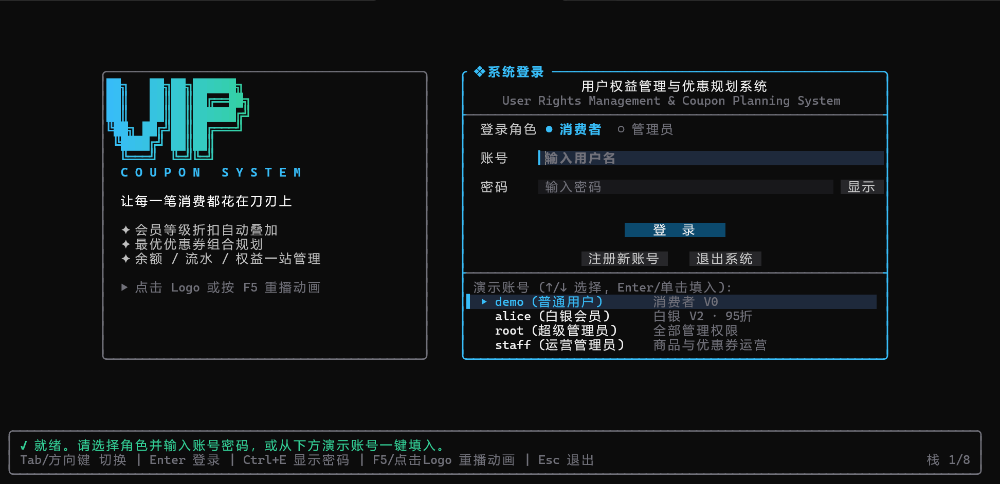
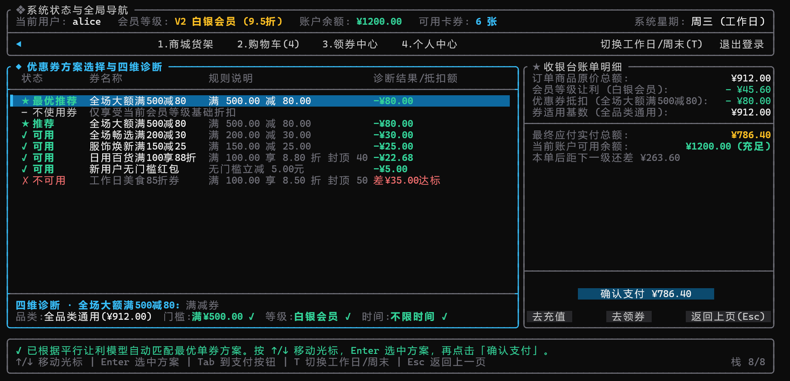
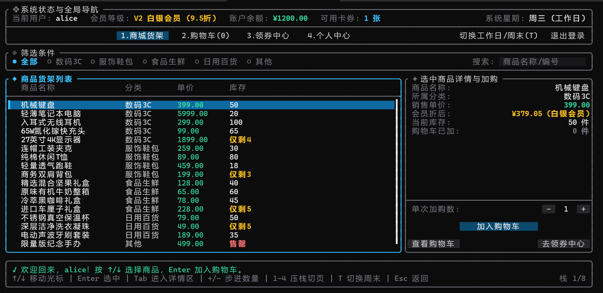
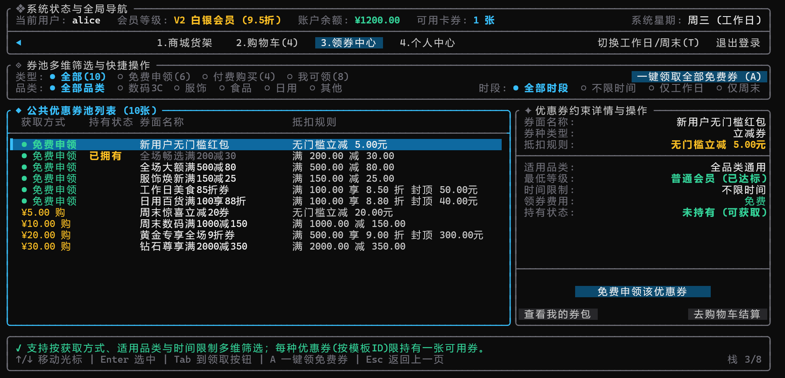
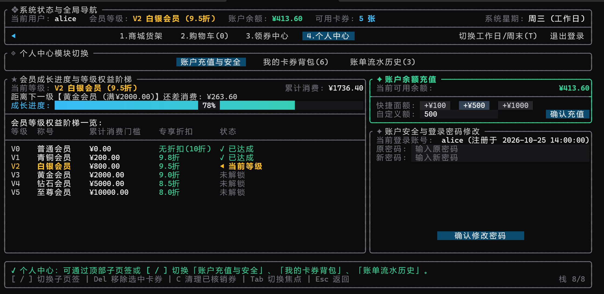
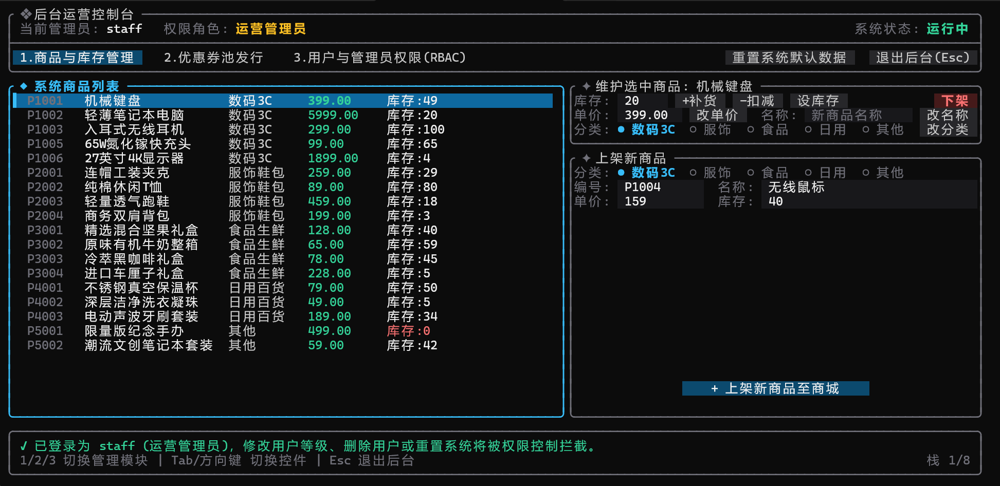
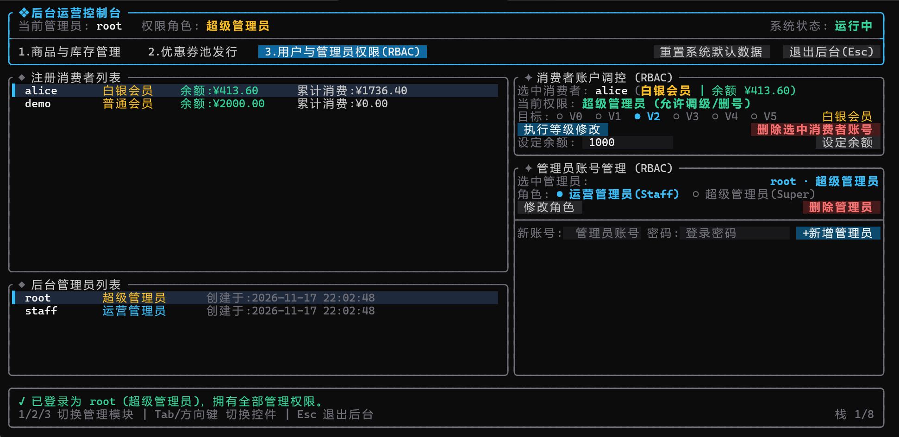

<div align="center">

# 用户权益管理与优惠规划系统

**User Rights Management & Coupon Planning System**

一个运行在终端里的电商收银与优惠规划程序，基于 C++17 和 FTXUI 实现。<br/>
登录后可以逛货架、加购物车、领券，进入收银台会自动算出最省钱的用券方案，消费达标后自动升级会员，也带有一套区分运营与超管的后台界面。数据以 JSON 保存在本地，首次启动会自动生成演示账号和商品。


[核心功能](#核心功能) · [智能收银与平行让利](#智能收银与平行让利) · [构建与运行](#构建与运行) · [演示账号与快捷键](#演示账号与快捷键)

<br/>



<sub>系统登录页：渐变 ASCII Logo（支持 <code>F5</code> 或点击重播动画）、角色切换与 4 个预设演示账号一键填入</sub>

</div>

---

## 核心功能

### 智能收银与平行让利

结算时，**会员基础折扣**与**优惠券抵扣**各自按商品原价计算，互不嵌套折上折：

```text
会员让利   = 订单原价总额 × (1 - 会员折扣率)
优惠券抵扣 = 对适用品类的原价小计按券种规则计算（满减 / 封顶折扣 / 立减）
最终实付   = max(0, 订单原价总额 - 会员让利 - 优惠券抵扣)
```

进入收银台后，系统会依次按 **适用品类 → 消费门槛 → 最低等级 → 生效时段（不限/工作日/周末）** 四个条件检查背包里的每张券，选出抵扣最多的一张作为默认推荐；条件不满足的券也会列出具体原因和差额，方便凑单或按 `T` 切换工作日/周末进行验证。

下图以 `alice`（V2 白银会员，9.5 折）的 ¥912.00 订单为例：会员让利 `¥45.60`，自动匹配最优券 `全场大额满500减80` 抵扣 `¥80.00`，最终实付 `¥786.40`，同时对未达标的 `工作日美食85折券` 直接给出 `差¥35.00达标` 的提示。

<div align="center">
  
</div>

<br/>

### 商品货架与购物车

- 覆盖**数码3C、服饰鞋包、食品生鲜、日用百货、其他**五大品类，冷启动默认提供 18 件商品（含低库存预警与售罄项）。
- 货架支持按品类筛选以及名称/编号联合搜索，选中商品后右侧同步展示当前会员等级对应的折后价。
- 购物车支持步进增减、直接设定数量、移除与清空，实时统计各品类小计与原价总额；结算前会对整单库存做全量预检，避免超卖。

<div align="center">
  
</div>

<br/>

### 优惠券与领券中心

- 支持三种券型：**满减券**、**折扣券（支持封顶额）** 和 **无门槛立减券**。
- 公共券池默认内置 10 张模板（6 张免费申领 + 4 张付费购买），支持按获取方式、适用品类与生效时段多维筛选，按 `A` 可一键领完当前所有可领免费券。
- 同一券模板在核销前严格限持一张，防止重复刷券。

<div align="center">
  
</div>

<br/>

### 会员成长与个人中心

消费者按累计消费金额分为 V0 到 V5 六个等级，每次结算扣款后自动检查是否达到晋升门槛，升级时会写入一条独立的升级流水记录：

| 等级 | 称号 | 累计消费门槛 | 全场基础折扣 |
| :---: | :--- | :---: | :---: |
| `V0` | 普通会员 | ¥0 | 原价（无折扣） |
| `V1` | 青铜会员 | ¥200 | 9.8 折 |
| `V2` | 白银会员 | ¥800 | 9.5 折 |
| `V3` | 黄金会员 | ¥2,000 | 9.0 折 |
| `V4` | 钻石会员 | ¥5,000 | 8.5 折 |
| `V5` | 至尊会员 | ¥10,000 | 8.0 折 |

个人中心内置**账户充值与安全**、**我的卡券背包**、**账单流水历史**三个子页签：可随时查看成长进度、快捷充值、修改密码（经 SHA-256 哈希存储）、清理已核销卡券以及追溯充值、消费、购券与升级四类流水。

<div align="center">
  
</div>

<br/>

### 双级管理后台（RBAC）

后台按角色做两级权限隔离：

- **运营管理员（Staff）**：负责商品上架/下架、改价、补货以及发布优惠券；触及调级、删号或重置系统等越权操作时会自动拦截并弹窗提示。
- **超级管理员（SuperAdmin）**：拥有全部管理权限，支持手动调整消费者等级与余额、注销用户、增删管理员账号以及两步确认出厂重置。

<table>
  <tr>
    <td width="50%" valign="top">
      
      <p align="center"><b>运营管理员（staff）</b><br/><sub>商品库存维护与发券，底部明确提示高危操作受权限拦截</sub></p>
    </td>
    <td width="50%" valign="top">
      
      <p align="center"><b>超级管理员（root）</b><br/><sub>完整 RBAC 控制：消费者调级/调额/销户、管理员维护与系统重置</sub></p>
    </td>
  </tr>
</table>

<br/>

### 终端交互与本地持久化

- **定深页面栈调度**：登录、商城、购物车、收银台、领券中心、个人中心、管理后台 7 个全屏页面统一由容量上限为 8 的页面栈管理，防止同页重复压栈，按 `Esc` 逐层回退；错误提示通过模态弹窗给出，并附带快捷跳转按钮。
- **本地 JSON 存储与冷启动**：数据文件（`users.json`、`products.json`、`coupons.json`）默认保存在可执行文件同级的 `data/` 目录下（即 `bin/data/`），无论从哪个工作目录启动都能稳定读写；文件缺失时自动注入种子数据，关键交易完成后立即刷盘。

---

## 构建与运行

### 环境要求

- **C++ 标准**：C++17
- **构建工具**：CMake（>= 3.21，配合 `CMakePresets.json` 使用）与 Ninja
- **编译器**：MSVC 2019+、GCC 9+ 或 Clang 10+
- **第三方依赖**（构建时通过 CMake `FetchContent` 自动拉取，无需手动安装）：
  - `nlohmann/json` (`v3.12.0`)
  - `FTXUI` (`v7.0.3`)
- **终端建议**：Windows 下推荐使用 Windows Terminal，Linux / macOS 使用常规支持 UTF-8 与真彩色的终端即可（支持鼠标点击与滚轮）。

### 1. 克隆仓库

```bash
git clone https://github.com/olxxx/vip-coupon-system.git
cd vip-coupon-system
```

### 2. 配置与编译（推荐使用 CMake Presets）

```bash
cmake --preset release
cmake --build --preset release
```

可用预设一览（运行 `cmake --list-presets` 可查看当前平台支持的全部预设）：

| 预设名称 | 说明 |
| :--- | :--- |
| `release` | **推荐**。Release 优化构建，使用系统默认编译器 |
| `debug` | Debug 构建（含调试符号），使用系统默认编译器 |
| `gcc-release` / `gcc-debug` | 指定使用 GCC (`g++`) |
| `clang-release` / `clang-debug` | 指定使用 Clang (`clang++`) |
| `msvc-release` / `msvc-debug` | 指定使用 MSVC (`cl`)，仅 Windows，需在 Developer Command Prompt 中执行 |

指定编译器构建示例：

```bash
cmake --preset gcc-release
cmake --build --preset gcc-release
```

所有预设的主程序统一输出至 `bin/vip-coupon-system`（Windows 下为 `bin/vip-coupon-system.exe`），后一次编译会覆盖前一次产物。

### 3. 运行测试（CTest）

```bash
ctest --preset release
```

使用其他预设编译时，对应传入同名测试预设（例如 `ctest --preset gcc-release`）。测试套件包含 9 个单元与集成测试程序、共 672 条断言，覆盖用户与权限、商品与购物车、多态优惠券与券池、规划引擎、JSON 持久化以及 TUI 页面集成流程（Release 模式下同样保持 `assert` 生效）。

### 4. 启动程序

可以直接运行编译产物，也可以通过自定义 `run` 目标启动：

```bash
# Windows
.\bin\vip-coupon-system.exe

# Linux / macOS
./bin/vip-coupon-system

# 或直接通过 CMake 目标启动
cmake --build --preset release --target run
```

---

## 演示账号与快捷键

### 预设账号

首次启动时若 `bin/data/` 下无数据文件，程序会自动写入以下 4 个账号（登录页也支持直接选中后一键填入）：

| 账号 | 密码 | 角色身份 | 初始状态 | 建议体验场景 |
| :--- | :--- | :--- | :--- | :--- |
| `demo` | `123456` | 消费者 | V0 普通会员，余额 ¥2,000 | 基础购物、领券、消费触发自动升级 |
| `alice` | `123456` | 消费者 | V2 白银会员，余额 ¥1,200，含 1 张满减券 | 体验 9.5 折与高门槛券平行让利 |
| `staff` | `staff123` | 管理员 | 运营管理员（Staff） | 商品上下架/补货、发券、验证 RBAC 越权拦截 |
| `root` | `admin123` | 管理员 | 超级管理员（SuperAdmin） | 手动调级/调额、销户、管理员管理与系统重置 |

### 常用快捷键

| 按键 | 适用范围 | 说明 |
| :--- | :--- | :--- |
| `Tab` / `Shift+Tab` | 全局 | 在输入框、列表与操作按钮间切换焦点 |
| `↑` / `↓` | 全局 | 上下移动列表选中项 |
| `Enter` | 全局 | 确认操作、选中商品/卡券方案或提交表单 |
| `Esc` | 全局 | 返回上一页；处于栈底时退出登录或关闭程序 |
| `1` ~ `4` | 消费者端 | 快速切换页面（`1` 商城 / `2` 购物车 / `3` 领券 / `4` 个人中心） |
| `T` | 消费者端 | 切换系统日期（周三工作日 / 周六周末），方便验证时段限制券 |
| `Ctrl+E` / `F5` | 登录页 | 显示或隐藏明文密码 / 重播 Logo 帧动画 |
| `+` / `-` | 商城、购物车 | 步进增减商品数量 |
| `Del` / `D`、`C` | 购物车 | 移除选中商品 / 清空购物车 |
| `A` | 领券中心 | 一键领取当前所有可领的免费券 |
| `[` / `]`、`C` | 个人中心 | 切换子页签（充值安全 / 卡券背包 / 账单流水）/ 清理已核销卡券 |
| `1` ~ `3` | 管理后台 | 切换后台模块（商品库存 / 优惠券发行 / 用户与权限管理） |
